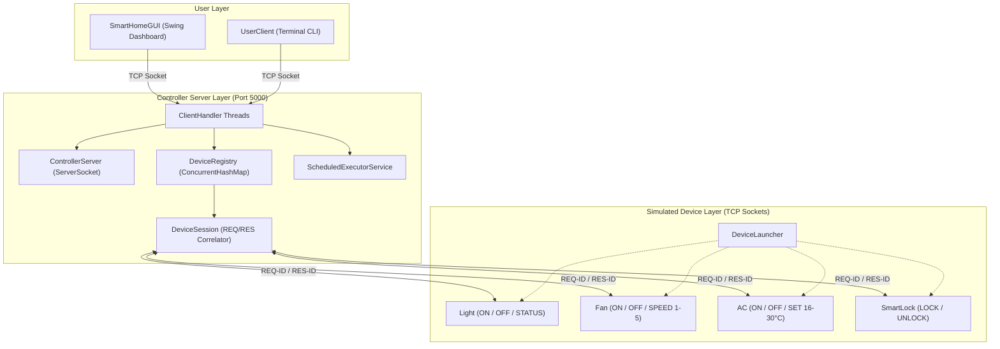

# Academic Project Report: Smart Home Controller with a Socket-Based Device Protocol

**Course:** Advanced Programming Practice (APP) / Distributed Systems  
**Implementation Language:** Pure Java (JDK 17+)  
**Architecture:** Client-Server Distributed System over TCP/IP Sockets  

---

## 1. Abstract

The modern Internet of Things (IoT) ecosystem relies heavily on distributed networking protocols that connect peripheral hardware appliances to central controllers. This project presents a pure-Java, hardware-independent **Smart Home Controller System** designed to demonstrate core computer science principles: socket programming, concurrent multithreading, object-oriented design (abstraction, inheritance, polymorphism, encapsulation), and custom protocol parsing. The architecture decouples device simulation from controller logic and user interaction. Four autonomous devices (**Smart Light**, **Ceiling Fan**, **Air Conditioner**, and **SmartLock**) communicate over TCP sockets with a central server that dynamically routes validated user commands from desktop GUI and CLI clients. An asynchronous request-response correlation engine ensures contention-free I/O under concurrent user requests.

---

## 2. Problem Statement

Physical smart home testbeds present significant hurdles in academic laboratories: hardware fragility, vendor-specific SDK dependencies, wireless interference, and financial cost. Furthermore, many students struggle to grasp the low-level mechanics of network sockets when obscured by heavy frameworks (such as Spring Boot, MQTT brokers, or HTTP web servers). 

There is a distinct need for a clean, zero-dependency, pure-Java distributed system that faithfully reproduces the asynchronous client-server mechanics of IoT devices using standard Java networking (`java.net.Socket`, `java.net.ServerSocket`) and concurrency primitives.

---

## 3. Objectives

1. Develop a central **Controller Server** using `ServerSocket` capable of orchestrating simultaneous connections from devices and users.
2. Implement **multithreaded connection handling** so no slow client or network delay blocks system operation.
3. Design and implement an **abstract device hierarchy** demonstrating inheritance and polymorphic command execution.
4. Build a robust, line-oriented **text protocol** with strict parameter boundaries (temperature 16–30°C, fan speed 1–5).
5. Implement an **asynchronous correlation mechanism** (`REQ-<id>` $\to$ `RES-<id>`) to eliminate socket race conditions.
6. Provide dual client interfaces: an interactive **CLI console** and a **Java Swing desktop dashboard**.
7. Validate the entire architecture with an automated, reproducible **14-point test suite**.

---

## 4. Hardware & Software Requirements

### Hardware Requirements
- **Processor:** Intel Core i3 / AMD Ryzen 3 or higher.
- **RAM:** Minimum 2 GB available RAM.
- **Storage:** 50 MB free disk space.
- **Network Interface:** Loopback adapter (`127.0.0.1`) or local Wi-Fi / Ethernet adapter.

### Software Requirements
- **Operating System:** Windows 10/11, Ubuntu/Linux, or macOS.
- **JDK:** OpenJDK or Oracle JDK 17 or newer.
- **Dependencies:** None (Standard Java SE class libraries only).
- **Optional Containerization:** Docker Engine 20+ & Docker Compose.

---

## 5. System Architecture & Component Design

The system adheres to a three-tier distributed architecture:

### Component Breakdown
1. **ControllerServer:** Listens on port 5000, accepts incoming connections, and spawns `ClientHandler` threads.
2. **ClientHandler:** Determines whether the connection is a device registration (`REGISTER <NAME>`) or user session (`REGISTER USER`).
3. **DeviceSession:** Owns the dedicated reader thread for a device socket. Uses `CompletableFuture` to correlate outgoing requests with incoming responses without cross-thread socket contention.
4. **DeviceRegistry:** Thread-safe registry using `ConcurrentHashMap` managing active device sessions, routing, and disconnections.
5. **Concrete Devices:** Independent clients maintaining true local states (`isOn`, `temperature`, `speed`, `isLocked`).

---

## 6. Text-Based Line Protocol Specification

Every message transmitted across the network is UTF-8 encoded and terminated with a newline (`\n`).

### 1. Registration Phase
- **Device Registration:**
  - Client $\to$ Server: `REGISTER <LIGHT|FAN|AC|SMARTLOCK>`
  - Server $\to$ Client: `OK REGISTERED <NAME>` or `ERROR DEVICE ALREADY REGISTERED: <NAME>`
- **User Registration:**
  - Client $\to$ Server: `REGISTER USER`
  - Server $\to$ Client: `OK REGISTERED USER`

### 2. User & Device Command Routing
- **Light:** `LIGHT ON`, `LIGHT OFF`, `LIGHT STATUS`
- **Fan:** `FAN ON`, `FAN OFF`, `FAN SPEED <1-5>`, `FAN STATUS`
- **AC:** `AC ON`, `AC OFF`, `AC SET <16-30>`, `AC STATUS`
- **SmartLock:** `SMARTLOCK LOCK`, `SMARTLOCK UNLOCK`, `SMARTLOCK STATUS`
- **System Commands:**
  - `LIST` $\to$ Returns comma-separated list of active devices.
  - `STATUS ALL` $\to$ Queries all devices and returns aggregate status:  
    `OK STATUS AC: OFF (24°C) | FAN: OFF | LIGHT: ON | SMARTLOCK: LOCKED`
  - `SCHEDULE <DEV> <ACTION> <SECS>` $\to$ Schedules delayed execution.

### 3. Asynchronous Correlation Mechanism
To avoid multi-threaded socket read conflicts, the server tags forwarded commands:
- Server $\to$ Device: `REQ-101 LIGHT ON`
- Device $\to$ Server: `RES-101 OK LIGHT IS ON`

The dedicated device session reader matches `RES-101` and releases the specific waiting user thread.

---

## 7. Object-Oriented Programming (OOP) Implementation

| OOP Concept | Project Manifestation | File Reference |
|---|---|---|
| **Abstraction** | Abstract class `Device` hides low-level socket streaming, registration, and reconnect loops, exposing abstract `processCommand()` and `getStatus()`. | [Device.java](file:///src/smarthome/device/Device.java) |
| **Inheritance** | Concrete devices (`Light`, `Fan`, `AC`, `SmartLock`) extend `Device`, reusing the networking engine while specializing device behavior. | [Light.java](file:///src/smarthome/device/Light.java), [Fan.java](file:///src/smarthome/device/Fan.java), [AC.java](file:///src/smarthome/device/AC.java), [SmartLock.java](file:///src/smarthome/device/SmartLock.java) |
| **Polymorphism** | The server/device engine invokes `processCommand()` polymorphically on any `Device` instance at runtime. | [Device.java](file:///src/smarthome/device/Device.java#L150-L160) |
| **Encapsulation** | Device states (`isOn`, `temperature`, `speed`, `isLocked`) are private and manipulated strictly through synchronized methods with boundary checks. | Device subclasses |
| **Multithreading** | Dedicated worker threads per client (`ClientHandler`), device reader threads (`DeviceSession`), and background network executors (`SwingWorker` / `ExecutorService` in `SmartHomeGUI`). | [ControllerServer.java](file:///src/smarthome/server/ControllerServer.java), [DeviceSession.java](file:///src/smarthome/server/DeviceSession.java) |
| **Thread-Safe Collections** | Concurrent registries and request tracking via `ConcurrentHashMap` and `Collections.synchronizedList`. | [DeviceRegistry.java](file:///src/smarthome/server/DeviceRegistry.java), [DeviceSession.java](file:///src/smarthome/server/DeviceSession.java) |

---

## 8. Verification and Actual Test Results

The automated integration test suite (`SmartHomeTestSuite.java`) was executed against the running system. All 14 test scenarios passed completely:

| # | Test Scenario Description | Expected Outcome | Actual Result | Status |
|---|---|---|---|---|
| 1 | Server Startup | Binds to port 5055 | Server bound and listening | **PASS** |
| 2 | Device Registration | Light connects and registers | Device added to `DeviceRegistry` | **PASS** |
| 3 | Command: `LIGHT ON` | Light state changes to ON | `OK LIGHT IS ON` (State: ON) | **PASS** |
| 4 | Command: `LIGHT OFF` | Light state changes to OFF | `OK LIGHT IS OFF` (State: OFF) | **PASS** |
| 5 | Command: `AC SET 24` | AC temperature set to 24°C | `OK AC TEMPERATURE SET TO 24°C` | **PASS** |
| 6 | Boundary: Invalid AC Temp (99°C) | Rejects out-of-bounds input | `ERROR INVALID TEMPERATURE: USE 16-30` | **PASS** |
| 7 | System Command: `STATUS ALL` | Aggregates all 4 devices | `OK STATUS AC: OFF (24°C) \| FAN: OFF \| LIGHT: OFF \| SMARTLOCK: LOCKED` | **PASS** |
| 8 | Command: `FAN SPEED 3` | Fan adjusts speed to 3 | `OK FAN SPEED SET TO 3` | **PASS** |
| 9 | Command: `SMARTLOCK UNLOCK / LOCK` | Lock state toggles cleanly | `OK SMARTLOCK IS UNLOCKED` then `LOCKED` | **PASS** |
| 10| Device Disconnection | Fan socket closed | Removed from `DeviceRegistry` | **PASS** |
| 11| Command to Disconnected Device | Request sent to disconnected Fan | `ERROR DEVICE NOT CONNECTED: FAN` | **PASS** |
| 12| Unknown Command Handling | Invalid syntax `MAGIC_DEVICE FIRE` | `ERROR UNKNOWN COMMAND` | **PASS** |
| 13| Concurrent Multi-User Requests | 2 clients issue parallel commands | Responses routed without cross-talk | **PASS** |
| 14| Graceful Server Shutdown | Server socket closed | All sessions cleanly terminated | **PASS** |

---

## 9. Viva Voce Preparation Guide (Questions & Answers)

### Q1: What is a Socket in computer networking?
> **Answer:** A socket is an endpoint for bidirectional communication between two processes running over a network. In Java, it encapsulates the IP address and port number, allowing data transmission via input and output streams over TCP or UDP.

### Q2: What is the key difference between `Socket` and `ServerSocket`?
> **Answer:** `ServerSocket` is used by the server to listen on a designated port for incoming connection requests via its `accept()` method. Once a connection request arrives, `accept()` returns a standard `Socket` instance, which is then used for actual data exchange with the connected client.

### Q3: Why is TCP preferred over UDP for smart home device control?
> **Answer:** Smart home commands (such as locking a door or adjusting an AC temperature) require guaranteed, in-order delivery and error checking. TCP provides connection-oriented, reliable transmission with acknowledgements and retransmissions, whereas UDP is connectionless and may drop or reorder packets.

### Q4: Why is multithreading necessary in this system?
> **Answer:** Without multithreading, a blocking call such as `in.readLine()` or `serverSocket.accept()` would freeze the entire application. Multithreading allows the server to simultaneously accept new connections, listen to multiple devices, and process user requests without blocking.

### Q5: How does the server know which device to contact when a user issues a command?
> **Answer:** The server utilizes a `DeviceRegistry` backed by a `ConcurrentHashMap<String, DeviceSession>`. When a command like `LIGHT ON` arrives, the `CommandParser` extracts the target device key (`LIGHT`), and the registry retrieves the matching `DeviceSession` to dispatch the command.

### Q6: How are device states maintained?
> **Answer:** Device states are encapsulated directly within each simulated device object (`Light.java`, `Fan.java`, etc.). The server does not maintain duplicate state variables; instead, whenever status is requested, the server queries the device over the socket, ensuring authentic simulated hardware behavior.

### Q7: Where are Inheritance and Polymorphism demonstrated?
> **Answer:** 
> - **Inheritance:** Concrete classes (`Light`, `Fan`, `AC`, `SmartLock`) extend the abstract base class `Device`, inheriting connection management and thread lifecycle logic.
> - **Polymorphism:** The base class declares abstract methods `processCommand()` and `getStatus()`. At runtime, the server or device engine invokes these methods polymorphically on whichever specific device subclass is active.

### Q8: What happens when a device abruptly disconnects?
> **Answer:** The device's dedicated reader thread in `DeviceSession` encounters an `IOException` or detects `in.readLine() == null`. The `finally` block executes `close()`, which purges the device from `DeviceRegistry` and terminates all pending requests with a descriptive error message. Subsequent user requests immediately receive `ERROR DEVICE NOT CONNECTED: <DEVICE>`.

---

## 10. Limitations & Future Enhancements

### Limitations
- Network traffic is plain text (no TLS/SSL encryption).
- Ephemeral in-memory state (resets upon server restart).
- Single-room simulated scope.

### Future Enhancements
- Integration of TLS/SSL sockets (`SSLSocket` / `SSLServerSocket`) for encrypted communication.
- Role-based user authentication and access control tokens.
- Persistent event history logging using an embedded database such as SQLite or H2.
- WebSocket bridge to support mobile web applications.

---

## 11. Conclusion

The Smart Home Controller project successfully demonstrates a pure-Java distributed system architecture. By decoupling the controller server, autonomous simulated devices, and user clients through a synchronized line-based protocol, the project illustrates how fundamental object-oriented programming concepts and socket concurrency solve real-world distributed systems challenges. All PRD requirements, error-handling routines, and verification test cases have been achieved and verified.
